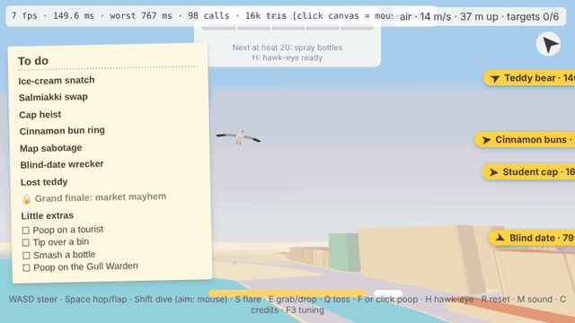
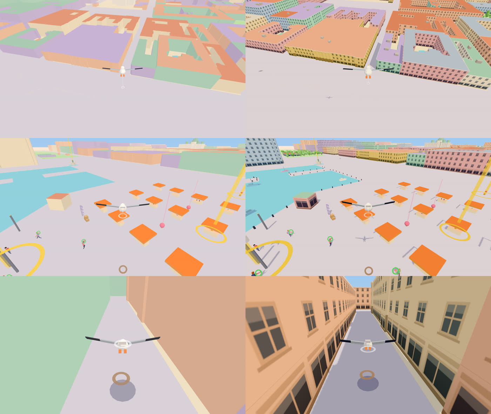

# Lokki

*Lokki* ("gull" in Finnish) is a browser-based 3D game: you are a seagull causing gentle slapstick havoc in downtown Helsinki. Low-poly, pastel, mouse + keyboard. See [`docs/PLAN.md`](docs/PLAN.md) for the full plan.

Status: **M13 – Market Square Act 1 (levels 1–4)** awaiting playtest. M0–M12 done.





## Run

Requires Node >= 22.

```bash
npm install
npm run dev        # dev server
npm run build      # static build in dist/
npm run preview    # serve dist/ locally
npm run preview:lan # serve dist/ to your phone on the same Wi-Fi (see docs/milestones/M11.md)
npm run lint
npm test           # unit tests (Vitest)
npm run test:smoke # Playwright smoke test (needs Chromium)
npm run data:build # regenerate data/generated/kauppatori.json from data/raw/ (Node >= 22.18)
npm run data:fetch # re-download the raw snapshot from Helsinki open data (needs network)
```

`?greybox` in the URL (e.g. `http://localhost:5173/?greybox`) loads the M1 test course instead of the city.

## Phones and tablets

Play in landscape with on-screen controls: left thumb steers (floating stick), drag the right half to look, **Flap**, **Dive** (slide to aim), **Poop**, a context **Grab/Drop** button, and a ☰ menu for everything else. Add `?touch` to the address to try the touch layout on a PC. Details: [`docs/milestones/M11.md`](docs/milestones/M11.md).

## Play with a friend (online co-op)

Press **N** (or Options → "Play with a friend online…"). One player hosts and sends an invite code, the other pastes it and sends back an answer code; no account and no game server. The host picks the levels and the guest follows. Only while setting up co-op, the browser asks a public STUN server (Google's) for its network address; single player makes no online request. Short room codes and a free relay for stubborn networks are optional: [`docs/online-setup.md`](docs/online-setup.md). Details: [`docs/milestones/M14.md`](docs/milestones/M14.md).

## Controls (M1)

| Key | Action |
|---|---|
| WASD | walk / steer (relative to camera) |
| Space | hop on the ground; flap in the air (hold to keep flapping, costs stamina) |
| Shift (hold) | committed dive along the camera aim (mouse up/down = steeper/shallower); release after the minimum time to swoop up |
| S (in the air) | flare / brake, for precise landings |
| Mouse | click canvas for mouse look (Esc releases) |
| E | grab (with the beak) / drop; prompt shows what is in reach |
| Q | toss what you carry |
| F or left click | poop (click only while the mouse is captured); ring shows where it will land |
| H | hawk-eye: briefly reveals the city's lines and nets |
| R | reset everything (gull, props, tourists, heat, deterrents) |
| V / G / B | skills: crow call (Mimic), flock call, pigeon disguise (once earned) |
| K | skills panel and gull looks (1–5 pick a look) |
| X / Z | extra objectives on/off, start a speedrun (after clearing the finale) |
| O | options (volumes, mouse look, screen shake, graphics quality, HUD) |
| U | HUD: full / minimal / off |
| L | level list (replay any unlocked level) |
| N | online co-op lobby (host or join a friend) |
| Gamepad | left stick move · right stick look · A/RB flap · RT dive · LT brake · X grab · Y toss · B poop · D-pad abilities · Back skills · Start options |
| T | skip the first-flight tips |
| M | mute / unmute (sound and music) |
| C | credits |
| F3 | debug panel: live tuning, "Copy tuning as JSON" |

## How it is built

- **Static and offline.** `npm run build` makes a self-contained `dist/` (relative paths, so it works under any sub-path). Nothing is fetched from third-party servers at runtime; the city is baked from a committed data snapshot, music is bundled, sound effects are synthesised.
- **Fixed-timestep simulation** (60 Hz) with render interpolation (`src/core/loop.ts`). Gameplay never depends on the frame rate; randomness is seeded.
- **Data-driven content.** Quests, skills, deterrents, props, NPC roles, triggers and music are plain typed data in `src/data/`; the logic in `src/gameplay/` reads them.
- **Pure logic, thin rendering.** Flight, heat, NPC brains, quests, skills, saving, abilities, music direction and the tutorial are pure TypeScript with Vitest tests; rendering code only mirrors state.
- **One tuning object.** Every feel parameter lives in `src/core/tuning.ts` and shows up in the F3 debug panel ("Copy tuning as JSON").
- **Procedural detail.** Facades (windows per bay and floor from one runtime-drawn tile), roofs, roof clutter and set dressing are generated from the same city data with seeded, unit-tested rules (`src/world/facade.ts`, `src/world/dressingPlan.ts`); repeated items are instanced. One shadow map follows the player on the high preset.
- **World pipeline.** `npm run data:build` turns the raw Helsinki open-data snapshot (`data/raw/`) into `data/generated/kauppatori.json`; buildings are chunk-merged meshes, static collision comes from the same data, and Rapier only simulates loose props.
- **The city fights back.** Heat tiers deploy vendors, scare lines, nets and the Gull Warden; each deterrent has a "learned" counter, so repeated dodges weaken it and the city brings in something new.

```
src/core      loop, input, tuning, audio, music, save/options
src/gull      flight state machine, procedural model and animation
src/world     city chunks, landmarks, collision
src/gameplay  props, interaction, NPC brains, heat, deterrents, quests, skills
src/render    camera, markers, decals, debris, flocks
src/ui        HUD, to-do note, menus, panels
src/data      quests, skills, props, music, tutorial (plain data)
tests/        unit (Vitest) and browser smoke tests (Playwright)
```

## Deploy

`.github/workflows/deploy.yml` builds and publishes `dist/` to GitHub Pages whenever `main` changes (work branches never deploy) (enable it once under Settings -> Pages -> Source: GitHub Actions). Any other static host works too: upload the contents of `dist/`.

## Audio

Sound effects are synthesised at runtime with WebAudio. Music is public-domain / CC0 classical and ragtime recordings (see credits below and `data/raw/SOURCES.md`).

## Data credits

- **Buildings, streets, parks, coastline:** City of Helsinki open data (Helsingin kaupunki), licence [CC BY 4.0](https://creativecommons.org/licenses/by/4.0/), © City of Helsinki. Layers and processing are recorded in [`data/raw/SOURCES.md`](data/raw/SOURCES.md).
- **Sound effects:** synthesised at runtime, no sample files.
- **Music** (public domain / CC0 recordings from Wikimedia Commons; details in [`data/raw/SOURCES.md`](data/raw/SOURCES.md)): Mendelssohn, *The Hebrides* Overture (Musopen Symphony Orchestra); Satie, *Gymnopédie* no. 1 (Robin Alciatore); Joplin, "Maple Leaf Rag" (US Air Force Band Strolling Strings); Offenbach, "Galop infernal" (Gnissah).
- **People:** "Animated Human" by [Quaternius](https://quaternius.com) (CC0), recoloured in code.
- Landmarks (cathedral, tents, ferry, statue) are original stylised props.

## Licence

MIT, see [LICENSE](LICENSE).
