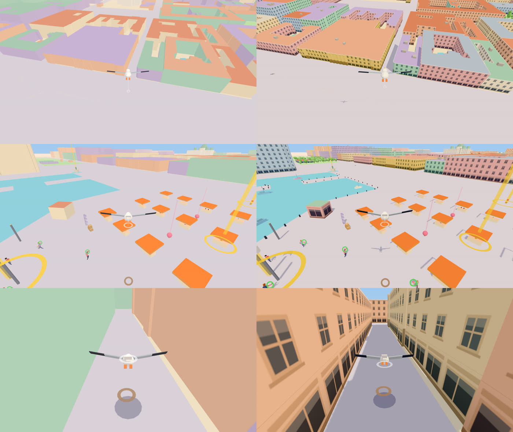

# M10 — Visual detail

## Goal
The city and its people read as detailed and charming up close, without leaving the pastel low-poly style or the performance budget (PLAN §4.4).

*Left: before M10. Right: after. Top: from the air; middle: the market; bottom: a street.*

## Built
- **Lighting** (`src/render/graphics.ts`): one soft 2048 shadow map in a 140 m box that follows the gull (snapped to texels so it does not shimmer), neutral tone mapping, hemisphere + sun levels in tuning (`render.*`). Buildings, people, big props, trees, umbrellas and boats cast; ground, water and buildings receive. **Ambient occlusion is baked** into the building vertex colours (darker wall feet, `render.ao`), so it costs nothing per frame. The blob shadows stay (they help judge height).
- **Graphics option** (O menu, "High quality graphics"): high = shadows + full pixel ratio; low = no shadow map, pixel ratio 1. Saved with the other options.
- **Buildings** (`src/world/facade.ts` rules, `src/world/city.ts` geometry, `src/render/facadeTextures.ts`):
  - Windows: one runtime-drawn window tile repeated per bay (≈3.4 m) and floor (3.2 m); a shopfront tile on the ground floor with a stone plinth. White areas of the tiles take the wall colour, so one texture serves every building.
  - Seeded pastel facades (cream, peach, mint, lilac, ochre, pink, blue) and painted tin roofs, cornice ledges on taller flat-roofed buildings, stairwell boxes and vents on flat roofs.
  - Pitched roofs on modest rectangular footprints (gable, or hip when squarish), with chimneys. Their collision is three stepped slabs, the top one a **perch**, so gulls can sit on ridges.
- **Landmarks:** a `restyle` entry in `data/landmarks.json` dresses up the registry building under it. **Uspenski Cathedral** now has red-brick walls, a green roof and gold onion domes (the domes are perches too). The Lutheran Cathedral, Havis Amanda, tents and ferry are unchanged.
- **People:** CC0 Quaternius "Animated Human" with seeded outfits, idle/walk/run/jump clips and arm overrides (see the earlier M10 commit and README credits).
- **Set dressing** (`src/world/dressingPlan.ts` pure placement, `src/world/dressing.ts` instanced meshes, one draw call per type): trees in parks (their canopies are perches), benches and café umbrellas in parks, bollards along the quays near the market, small boats off the quays, groups of bikes in streets. Placement keeps clear of buildings, the market, the ferry and quest props; the spots nearest the market win when a type hits its limit.

## Performance (1280×720, headless software renderer, so frame times are not meaningful; draw calls and triangles are)
| View | High: draw calls / triangles | Low: draw calls / triangles |
|---|---|---|
| Start (market) | 173 / 132k | 123 / 89k |
| Market square | 185 / 132k | 135 / 90k |
| Aerial | 130 / 129k | 83 / 87k |
| Street | 112 / 113k | 70 / 68k |
| Park | 122 / 125k | 82 / 79k |
| High above the city | 175 / 137k | 157 / 100k |

Before M10 the same views were about 45–60 draw calls and 25k triangles. Everything stays under the ~200 draw-call budget; the shadow pass is most of the increase on high (only props of 1 kg or more cast shadows, to keep it there).

## Deviations from the plan
- **No screen-space AO pass and no outline pass.** AO is baked into vertex colours instead (free at runtime, safe on integrated GPUs); the outline pass was optional and is left out to keep draw calls and fill-rate in budget.
- **City Hall and the Old Market Hall are not restyled.** I could not confirm which registry buildings they are from the coordinates I had (City Hall matched nothing within 30 m; the "market hall" match was a small narrow building), so I left them as normal buildings rather than mislabel the wrong ones. Adding them later is one `restyle` line each once the right spot is known.
- Tourists without a role hat get a sun hat at random (about one in three).

## Exit criteria
- [ ] Before/after screenshots show a clear jump in detail
- [ ] Still smooth (60 fps target) on your laptop at 1080p with "High quality graphics"; low preset as fallback
- [ ] Draw calls stay under ~200 (F3 shows them)
- [ ] No gameplay regressions (perching on roof ridges and trees, NPC walking, quests)

## Playtest notes
(to be filled in by the user)
