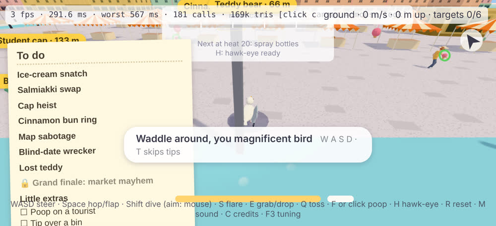

# Spike: can Lokki run in a mobile browser, in landscape?

**Verdict: yes, it is feasible**, with medium effort (about one milestone, M-sized) and no change to gameplay code. The game already boots on emulated phones; the work is a touch-control layer, a phone-sized HUD, a lighter graphics preset, and a few iOS/Android browser quirks. The one real unknown is GPU speed on actual phones, which only a test on real devices can answer.

This is a feasibility study only: nothing was implemented.

## What I checked

| Check | Result |
|---|---|
| Boots in mobile emulation (Playwright, iPhone 13 and Pixel landscape, touch on) | Yes. WebGL2 available, no console errors, ready in about 1.5 s on a local server |
| Input architecture | Every control goes through one `Input` class (`src/core/input.ts`) keyed by key codes: `axes()` for movement, `isDown('Space'/'Shift')`, `wasPressed('KeyE'…)`, and a mouse-look delta. 19 distinct keys are used in `main.ts`. A touch layer can feed the same class with virtual keys, an analog stick and look deltas, so **gameplay code does not change** |
| Download size | 14 MB on disk. Compressed (gzip): game code 0.3 MB, physics (Rapier, WASM inside JS) 1.6 MB, people model 0.7 MB; music 6.8 MB of Ogg is streamed per track, not loaded up front. Roughly 3 MB before you can play: fine on 4G |
| Rendering cost today | High preset: up to ~190 draw calls, ~165k triangles, a 2048 shadow map, pixel ratio up to 2. Low preset: ~90–160 calls, no shadows, pixel ratio 1 |
| Screen space | iPhone 13 landscape in Safari is about **750 × 342 CSS px** (browser bars take the rest); Pixel 7 about 863 × 360. The desktop HUD does not fit (see screenshot) |



*Today on an emulated iPhone in landscape: the to-do note covers ~40% of the screen, the keyboard hint bar and the debug FPS line are shown, and the title card is taller than the screen.*

## Proposed touch controls (landscape, two thumbs)

```
┌──────────────────────────────────────────────────────────────┐
│ [☰]  ▸ Ice-cream snatch 0:42          [heat ▮▮▯]  [👁 hawk]   │  ← slim top bar; ☰ opens a menu
│                                                              │
│                                                  [V][G][B]   │  ← ability chips (tap)
│     drag anywhere on the right half = look / aim            │
│                                                    ( GRAB )  │  ← context button, labelled
│   ◯ ← floating stick                    (POOP)      "Grab bun"│     only when something is in reach
│  (appears under                                (DIVE)        │
│   the left thumb)                                 ( FLAP )   │  ← big, under the right thumb
└──────────────────────────────────────────────────────────────┘
```

| Action (keyboard today) | Touch |
|---|---|
| Walk / steer (WASD) | **Floating joystick**: touch anywhere in the left ~40% and drag. It is analog, which the flight code already accepts (`ax`, `ay` are numbers). Pulling back while flying = flare/brake (today's S) |
| Look around (mouse) | **Drag on the right half** (outside the buttons). Optional auto-camera that eases back behind the gull when you are not dragging, because the right thumb also presses buttons |
| Flap / hop (Space, hold) | Big **FLAP** button under the right thumb; hold to keep flapping |
| Dive (Shift, hold; mouse aims) | **DIVE** button you hold *and slide*: slide up/down to make the dive shallower/steeper (replaces mouse aim, since the right thumb is busy) |
| Grab / drop (E), toss (Q) | One **context button** labelled with what it will do ("Grab bun", "Drop", from the existing grab prompt); a small **Toss** button appears only while carrying |
| Poop (F / click) | **POOP** button with its cooldown ring; the existing landing reticle shows where it will hit |
| Hawk-eye (H) | Eye icon next to the heat meter |
| Mimic / Flock / Disguise (V/G/B) | The existing ability bar becomes tappable |
| Skills & looks (K), options (O), restart (R), mute (M), credits (C), extras (X), speedrun (Z), skip tips (T) | **☰ menu** with big buttons (the game already pauses while a panel is open) |

Alternatives considered: tilt-to-steer (needs a motion-permission prompt on iOS and is tiring; maybe an option later); tap-to-move (doesn't suit flight). Gamepads (already in the backlog) would plug into the same input layer.

## Work needed (if we go ahead)

1. **Input layer (S–M).** Add virtual inputs to `Input` (`setVirtual(code, down)`, `tapVirtual(code)`, analog stick, look delta) and a `TouchControls` overlay (`src/ui/touchControls.ts`) using pointer events with multi-touch tracking. Show it only on touch devices (`pointer: coarse`). Pure parts (stick maths, dive-slider mapping, which button is under a finger) get unit tests.
2. **Phone HUD (S–M).** Compact to-do note (just the active quest, tap to expand), hide the keyboard hint bar and debug line on touch, a title screen that fits 340 px of height, scrollable skills/options panels, bigger tap targets (≥ 44 px), tips that name buttons instead of keys, and respect the notch (`env(safe-area-inset-*)`).
3. **Mobile graphics preset (S).** Automatic on phones: pixel ratio capped around 1.25–1.5 (phones report 3, which is 4–6× the pixels), no shadow map (blob shadows stay), camera far plane ~450 m instead of 1500 m so distant chunks are culled, fewer trees/boats/bikes. Keep the in-game toggle.
4. **Browser quirks (S).**
   - Stop the page from scrolling, zooming or long-press selecting while you play (`touch-action: none`, no text selection, no double-tap zoom).
   - **Landscape:** Android Chrome can go fullscreen and lock to landscape after a tap. **iPhone Safari cannot** lock orientation or go fullscreen for a web page, so show a "rotate your phone" card in portrait, and offer **Add to Home Screen** (a small web-app manifest: landscape, fullscreen), which removes the browser bars and gives back ~20% of the height.
   - Audio: start sound on the first touch (`touchend`/`click` as well as `pointerdown`, for older iOS).
   - Pause when the tab goes to the background (`visibilitychange`), and reload the scene if the phone drops the WebGL context.
5. **Real-device testing (needs you).** Emulation proves layout and touch, not GPU speed. A test on one mid-range Android and one iPhone (frame rate, heat/battery after 10 minutes, control feel) decides the final preset.

## Risks

| Risk | Mitigation |
|---|---|
| Too slow on older/low-end phones | Mobile preset above; a quality slider; draw-call budget for mobile ~100 |
| iPhone browser bars eat height; no orientation lock | Rotate prompt, Add to Home Screen, compact HUD |
| Thumbs cover the action | Floating stick, buttons in the corners, camera framing slightly higher on touch |
| Dive aiming feels worse than with a mouse | Slide-on-DIVE lever, plus a little aim assist (poop already has assisted targeting) |
| Phones heat up and throttle | Cap at 30 fps option on the mobile preset |

## Recommendation

Feasible and worth a dedicated milestone (e.g. "M11 Mobile landscape", size M). Do the input layer and phone HUD first and test on a real phone early, before polishing, because control feel and GPU speed are the two things this spike could not measure.
